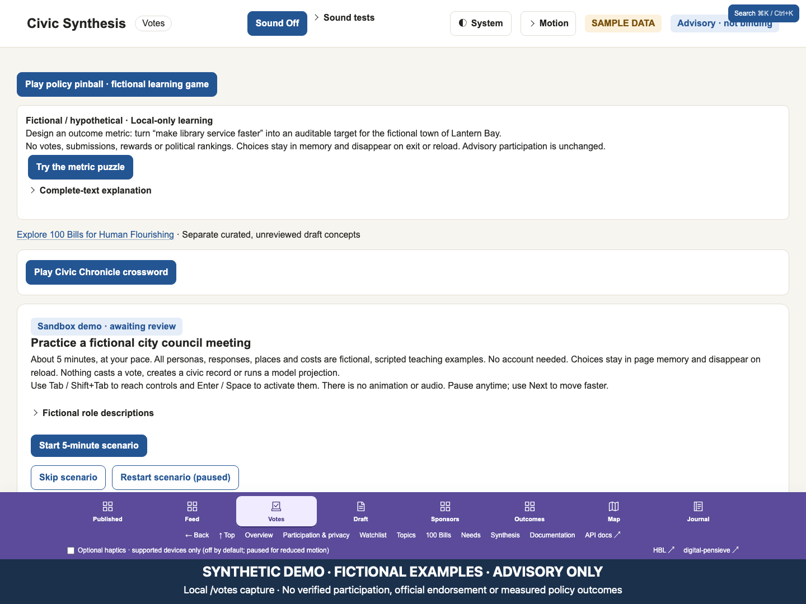

# Civic Synthesis beta announcement pack

Draft for product and trust review; not approved for publication. Prepared against
repository revision `590ad86d35c783df9cd5844ac577e2fedbd7b28d`.
Refs: https://linear.app/shel-bernstein/issue/SHE-984/cs-l100095-produce-a-nonpartisan-source-labeled-launch-announcement

## Short announcement

Civic Synthesis is an independent advisory beta for exploring everyday needs,
comparing civic ideas and trying fictional policy scenarios. Read without
participating, or explore the optional sample walkthrough. Sample proposals,
tallies and simulations are labeled; they are not a public opinion poll or
predictions. Advisory responses do not cast an official ballot, enact legislation,
contact an office or approve a code merge. This is not government-affiliated or
election infrastructure, and no official endorsement is claimed.

Explore: https://civic-synthesis.fly.dev/documentation
Before contributing, read [privacy and removal](https://civic-synthesis.fly.dev/privacy)
and [known limitations](#known-issues-and-limitations).

Source: repository public guide [S1], demo fixtures [S2] and privacy notice [S3].
The URL is the supplied beta starting point; availability and deployed revision
must be checked by a human before sharing.

## FAQ

**What can I do?** Read source-labeled examples, compare ideas and try optional
fictional learning activities. The guide explains journal → needs → comparison →
proposal → future. Reading does not require publishing or voting. [S1]

**Is this an official service or a poll?** No. It is an independent prototype.
Browser cookies do not verify people, residency or eligibility. Clearing cookies
or changing browsers can create another identity. Sample totals are fictional;
saved advisory choices are separate. Neither establishes representative public
opinion or one person, one vote. [S1, S2, S3]

**Will my response change law or reach an official?** No official action is
promised. Sponsor preparation is a demonstration; simulated replies and outcomes
are not evidence of contact, endorsement or policy adoption. Browser advisory
responses cannot authorize repository merges. [S1, S4]

**What does a source label establish?** Check whether an item is a fictional
sample, a simulation, an editorial interpretation or an imported official record.
Agency links beside fictional proposals provide background only. They do not
verify invented clauses, impacts or tallies. Imported metadata can be stale;
follow the original record and check dates and jurisdiction. [S1, S2]

**Is my journal private?** No, if published. Text, display name, time, labels and
needs are public, including through APIs and other people's copies. Avoid personal
or sensitive information. Some journal interfaces may send text to a configured
AI provider; local extraction is used without provider credentials. Read the
privacy notice before submitting. [S1, S3]

**Can I remove contributions?** The publishing browser offers Delete my entry.
Losing its cookie can prevent self-service deletion. Removing a journal does not
rewrite independent proposals or their ballots. Advisory responses have withdrawal
controls; historical repository records are separate. Backups, logs and others'
copies may remain without a guaranteed deletion schedule. [S1, S3]

**How do I report a problem?** Use the
[public repository issue form](https://github.com/adnanwahab/dear_congress/issues/new).
A GitHub account is required. Include the page, expected behavior and source link;
do not include private text, identifiers or credentials. No private contact channel
is currently published. [S1, S3]

## Privacy and limitations statement

Participation is optional and advisory. Published journals, proposals and comments
are public. A signed browser cookie links contributions but does not verify a
person. Hosting, configured AI services and map providers can process requests;
provider retention varies. There is no automatic expiry for published content or
votes, and no guaranteed backup/log deletion schedule. Browser-local features may
be visible to others sharing that profile. This prototype is not a private diary,
legal advice, an official election service, a representative poll or evidence that
a policy works. Read the current [privacy notice](https://civic-synthesis.fly.dev/privacy)
and [participation guide](https://civic-synthesis.fly.dev/account). [S1, S3]

## Demo screenshot

Caption: Local prototype screenshot with fictional learning examples. Synthetic
demo; advisory only. It demonstrates interface behavior, not participation,
government endorsement or policy outcomes. Keep the watermark and caption when
sharing. Text alternative: read the FAQ and source-label explanation above.

Provenance: supplied worktree capture `.mini-symphony-evidence/SHE-984-before-desktop-2.png`,
route `/votes`, desktop 1440×1000, capture manifest timestamp
`2026-11-16T00:55:58.632Z`. Added only an external footer watermark; retained the
entire original screenshot. This is local visual evidence, not a fresh production
capture or proof that the deployed beta matches this revision. No real contributor
text, identifiers or vote receipts are visible. Image output is 1440×1080.

## Known issues and limitations

This section is the pack's known-issues link; share it together with the announcement.

- Browser identity is unverified and cannot establish unique people or eligibility. [S1, S3]
- Fictional sample counts, simulated populations, costs and scenarios are not measured public opinion or validated impacts. Background citations are not claim verification. [S1, S2]
- Sponsor workflows and replies are demonstrations, not operational outreach. [S1, S4]
- Public journal deletion cannot retract others' copies or guarantee backup/log expiry; private removal intake is unavailable. [S3]
- Human-reviewed Spanish is pending; broader accessibility and production readiness must not be implied by this pack. [S1, S4]
- Readiness plans and target workloads are assumptions, not measured capacity promises. This pack does not certify live availability, deployment parity or security acceptance. [S4]

## Source register

These are repository implementation sources, not independent verification of real-world effects.

| Label | Source | Supports |
| --- | --- | --- |
| S1 | [Public guide](../../src/client/public-guide.ts) | Advisory boundaries, source distinctions, optional reading, sharing, feedback and language limitations |
| S2 | [Demo fixtures](../../src/engine/demo.ts) | Fictional proposals and totals; institution links are background only |
| S3 | [Privacy notice](../../src/server/privacy-page.ts) | Public fields, cookie identity, processing, retention and removal |
| S4 | [README](../../readme.md), [readiness plan](../launch-readiness.md) | Prototype workflows and operational limits; readiness dates are plans |
| S5 | [Merge and release policy](../launch-merge-policy.md) | Human review, required checks, source governance defaults and tagged releases |

## Human review before publication

| Required owner | Review scope | Current decision |
| --- | --- | --- |
| Product owner — maintainer to designate | Current deployed behavior, links, screenshot relevance and plain-language accuracy | Pending; no approval recorded |
| Trust owner — maintainer to designate | Nonpartisanship, source labels, privacy, limitations and consent | Pending; no approval recorded |

Record reviewer identity, exact commit, date, requested corrections and explicit
decision here before use. Any material copy or asset revision requires renewed
review. No owner identities or endorsements have been invented. Keep SHE-984 open
until both owners review the current pack and a human verifies acceptance.
Sharing remains a human action; preparation authorizes no external messages,
unconsented outreach or targeting by political stance.
