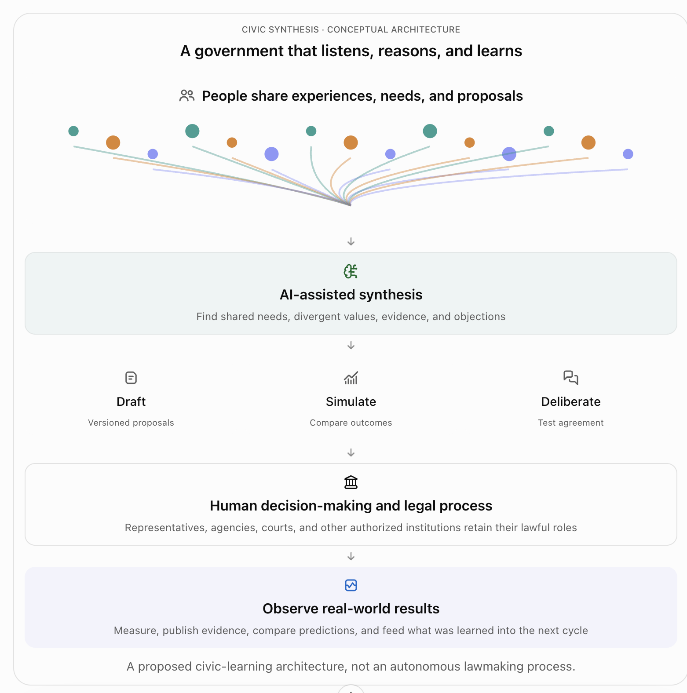

# Dear Congress · Helios frontend

----

12-month implementation roadmap
1. November 2026 – February 2027
   
   Build the accountable participation foundation: persistent proposals and amendments, revision history, identity protections, privacy controls, evidence citations, and transparent human-review status.

hypothesis: if the plan is good enough, hopefully everyone wants to support it. so we can iterate till it gets 100% support and carefully design to save iteration cycles.

“Every constitution, then, and every law, naturally expires at the end of 19. years.” - thomas jefferson

4 inherent challenges governements have faces across time - weakening connections with citizens, accumulated bureaucracy, constrained public finances, and institutions that react to problems rather than anticipate them

- this app improves connection between governments and citizens, 
- accumulated beauracacy can be refactored and voted away or replaced with an improved thing - sometimes today tihs may not get voted for because its not especially glamorous
- constrained public finances - hopefully a unanimous plan may be more efficent??
- institutions that react to problems rather than anticipate them - this is a difficult one but this app creates lots of new data that can hopefully inform systems that help predict the future

Problem	Why it's difficult	Possible design response
1. Conflicting human needs	What helps homeowners may hurt renters; what benefits workers may increase business costs	Make trade-offs and distributional effects visible
2. Collective decision-making	Millions of reasonable preferences cannot always become one universally accepted choice	Deliberation, transparent decision rules, protected dissent
3. Information gaps	Government rarely knows everyone's circumstances or the effects of every possible policy	Continuous, voluntary civic feedback
4. Slow institutional learning	Evidence arrives after decisions, and findings may not influence future choices	Regular reviews and independent evaluation
5. Bureaucratic complexity	Rules accumulate, agencies overlap, and ordinary tasks become difficult	Simplify processes without eliminating necessary protections
6. Corruption and capture	Wealthy or highly organized interests may gain disproportionate influence	Disclosures, independent audits, transparent decisions
7. Short-term incentives	Immediate political and budget pressures conflict with long-term needs	Long-horizon planning and future-generation impact assessments
8. Unequal participation	Time, money, language, access, and digital literacy affect whose views are heard	Accessible participation and representative citizen panels
9. Difficult implementation	Passing a policy does not guarantee that agencies can deliver it	Operational plans, accountable owners, funding, capacity tests
10. Uncertainty and crises	Climate, economic, technological, and security risks interact in unpredictable ways	Scenario planning, resilience, and reversible interventions

# References
https://plato.stanford.edu/entries/arrows-theorem/index.html?utm_source=chatgpt.com
https://chain.link/
Policy Paradox, followed by Getting to Yes, and then Governing the Commons

How would we know if it worked?
I'd evaluate the pilot using a balanced set of measures rather than one flourishing score.
Measure	Example question
Civic voice	Do more people feel their concerns are considered?
Representation	Whose voices are missing?
Response time	How long before a submitted concern receives a meaningful response?
Implementation	Which accepted proposals resulted in verifiable action?
Outcomes	What changed for affected people compared with an appropriate baseline?
Distribution	Who benefited, who experienced costs, and who was overlooked?
Accountability	Can a decision be explained, challenged, and corrected?
Cost	Does the benefit justify the expense and administrative burden?

Aristotle's eudaimonia, Sen and Nussbaum's capabilities, theories of democratic deliberation, constitutionalism, and social-choice theory.
