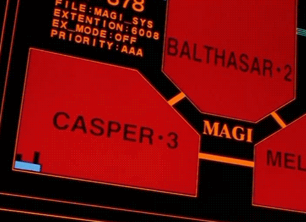
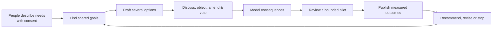

# Dear Congress · Civic Synthesis

### Listen every day. Find common ground. Test ideas. Improve public policy.

**Dear Congress** is an open-source experiment in making democracy a continuous, evidence-informed conversation instead of something people can meaningfully influence only every few years.

We want to make it easier for people to describe what they need, discover where their goals overlap, deliberate over concrete proposals, and follow ideas from a first draft through real-world outcomes.

**Our ambition:** an inclusive path toward the broadest possible consensus, a much shorter feedback loop between public problems and public responses, and a transparent place to test proposed improvements before scaling them.

[**Explore Civic Synthesis**](https://civic-synthesis.fly.dev/) · [**Browse proposals**](https://civic-synthesis.fly.dev/bills) · [**Explore voting**](https://civic-synthesis.fly.dev/vote) · [**View the code**](https://github.com/adnanwahab/dear_congress)

> **Prototype, not government.** This project includes demonstrations, synthetic examples, advisory participation, and experimental tools. It is not an official election, legislative body, or source of legal authority. A website vote does not enact a law, and an AI-generated draft is not an introduced bill. Check the source and status of every proposal.

---

## Three north stars

| Goal | What success might look like | What we will not pretend |
| --- | --- | --- |
| **1. Consensus through participation** | More people can participate, understand each other, and support a proposal they helped improve. | A unanimous result among a few respondents is not the consent of everyone. |
| **2. Lower legal latency** | Public needs are acknowledged daily, workable proposals are revised in days, and responsible institutions can respond faster. | Our software cannot bypass legislatures, due process, public comment, courts, or constitutional requirements. |
| **3. Policies that learn** | Proposed changes are compared, simulated, piloted where legally permitted, independently evaluated, and revised using observed outcomes. | A simulation is not proof that a policy will work in the real world. |

## The civic synthesis loop

This is our **target workflow**, not a claim that every step is implemented or legally authorized today. The original account of a need, the proposal version, the vote, the simulation assumptions, and the observed evidence should remain distinct and traceable.

## 1. How do we move toward 100% unanimous consensus?

**By building agreements people can genuinely endorse—not by hiding dissent or optimizing a vote total.**

Perfect agreement across an entire population is unlikely, and it must never be manufactured through pressure, selective participation, or changing the electorate. The useful ambition is to **keep revising proposals until the underlying needs of more people are addressed**, while protecting everyone's right to disagree.

### A practical consensus-building method

1. **Listen for needs before positions.** People may disagree about a policy while agreeing that housing should be affordable, streets safe, or public services reliable. Journals and comments should not be treated as votes.
2. **Show common ground across viewpoints.** Surface goals supported across different groups, not just the most popular opinion. Display uncertainty and missing representation.
3. **Offer several options and a no-change baseline.** Explain expected benefits, costs, trade-offs, affected groups, rights implications, and what is not known.
4. **Invite objections and amendments.** Ask *“What would need to change for you to support this?”* Keep objection histories visible and offer accessible ways to propose alternatives.
5. **Compare consequences.** Use transparent models and, when appropriate, carefully reviewed real-world experiments. New evidence can change a proposal; it must not rewrite someone's recorded vote.
6. **Vote on a specific version.** Provide support, oppose, and unsure choices; show the exact text, eligibility, window, tally method, and distinct participation denominator. Substantial amendments should trigger a fresh vote.
7. **Report both agreement and disagreement.** Record minority objections, unanswered questions, and reasons for stopping. Where unanimity is unavailable, use a published, legitimate decision rule rather than holding everyone hostage to an impossible threshold.

### What does “100% consensus” mean?

Suppose 100 people cast a vote and all 100 support a proposal. That is **100% support among those 100 participants**. If 1,000 people were eligible to participate, turnout was only **10%**. Neither statistic proves that everyone in the community agrees.

A trustworthy dashboard should report these separately:

- **Support among participating voters:** support / (support + oppose + unsure), with the voting window and version.
- **Participation:** participating eligible people / eligible electorate, *only when both eligibility and personhood are actually verified*. Otherwise report distinct accounts or browsers honestly.
- **Cross-group agreement:** support across voluntarily and appropriately measured groups; protect privacy, avoid profiling, and never erase minority concerns.
- **Deliberative improvement:** how many objections were addressed, proposals revised, participants informed, and affected people able to challenge a summary.

**Our goal is 100% opportunity to be heard and increasingly shared solutions—not a mandatory 100% “yes.”** Civil rights and fundamental protections are not waived merely because a majority, or even a large majority, supports something.

### Next feature: Consensus Workbench (proposed)

**Turn a “No” into a constructive amendment—without asking anyone to abandon their principles.**

The **Consensus Workbench** is a proposed deliberation space where participants can explain what would need to change for them to support a specific proposal. HELIOSAI can help organize objections and suggest **reviewable alternative drafts** that respond to multiple concerns. People—not the model—decide whether the new version earns their support.

#### Example journey

1. **Read and vote.** A person reviews a particular proposal version and chooses **Support**, **Oppose**, or **Unsure**. Their recorded choice is never inferred from a comment.
2. **Explain an objection (optional).** Someone who votes **Oppose** or **Unsure** may answer: **“What would need to change for you to support this?”** A person who supports the proposal can suggest improvements too.
3. **Identify common ground.** HELIOSAI groups similar *arguments and requested changes*, points out genuine agreement, and preserves incompatible objections separately. Summaries remain editable, attributable only with consent, and open to challenge.
4. **Propose amendments.** Participants or human reviewers can turn ideas into amendments. HELIOSAI may generate multiple clearly labeled draft options and a **no-change** option, with clause-level diffs, trade-offs, source citations, and uncertainty.
5. **Review and compare.** Show the original, each amendment, affected groups, relevant evidence, and optional [HappyBearLandia](https://github.com/adnanwahab/happybearlandia) simulation scenarios. Simulated impacts stay labeled as forecasts, not observed outcomes.
6. **Publish a new version for a fresh vote.** A human moderator/editor approves publication of a revision. Substantive changes create a new version and open a new advisory ballot; earlier votes and objections remain traceable rather than being silently transferred.
7. **Learn from remaining disagreement.** Track which objections were addressed, which remain unresolved, how participation changes, and whether the revised text earns broader **voluntary** support across the eligible participant population.

**The product question changes from “Did this proposal win?” to “What would make this proposal better for more people?”**

#### First MVP

- A **“Suggest an amendment”** action beside the advisory vote, with an optional objection field and a direct-edit option for people who prefer to draft text themselves.
- A public **objection and amendment board** showing status: *open → under discussion → included, declined, or unresolved*, with human-written reasons and privacy-aware moderation.
- A HELIOSAI **“Compare draft options”** assistant that summarizes proposed changes neutrally, cites the comments/evidence it actually used, and produces side-by-side diffs for **human review**.
- A **proposal-version timeline** that connects each draft, objection, amendment, human decision, and separate advisory vote, with counts and participation denominators.
- A progress view tracking **objections addressed, versions deliberated, participant coverage, and unresolved concerns**. Never show “100% consensus” without specifying the exact electorate, version, and denominator.

**Guardrails:** Participation is voluntary; the right to dissent remains protected. No AI-generated vote, assumed consent, targeted political persuasion, automated legal enactment, or automatic GitHub merge. Legally protected rights, private journals, minority concerns, accessibility, and human review are not negotiable shortcuts.

This is a **proposed feature**, not a claim that the complete Consensus Workbench is already implemented.

## 2. Lower legal latency: from years toward daily feedback

**Legal latency** is the time between a public problem being noticed and a useful, accountable response. We want to shrink the parts of that delay that better software, participation, and institutions can responsibly improve.

There are at least four different clocks:

| Clock | Start → finish | Proposed direction, not current performance |
| --- | --- | --- |
| **Listening latency** | Someone reports a problem → it is acknowledged and categorized | **Daily**, with the person's consent and a correction path |
| **Proposal latency** | A validated need → a readable, sourced, versioned option | **Days to a week**, including human review |
| **Decision latency** | A reviewed proposal → a documented institutional response | Track by institution; seek faster responses without bypassing required procedures |
| **Outcome latency** | An authorized change → measured benefits, harms, and costs | Monitor continuously; publish when data is sufficient |

**The aspiration is daily civic learning, not magically enacting a new federal law every day.** Congress, state legislatures, agencies, and local governments each have their own legal authorities and procedures. Federal bills must go through the constitutional lawmaking process; citizen voting here remains advisory unless a lawful institution separately creates an authorized process. See the [Congressional Research Service's explanation of the legislative process](https://www.congress.gov/crs_external_products/R/PDF/R42843/R42843.17.pdf).

### A possible operating cadence

| Every day | Every week | Every month or policy cycle |
| --- | --- | --- |
| Read new **consented** needs, make summaries correctable, accept explicit advisory votes and objections, update public issue clocks. | Draft and review **proposed policy patches**, publish differences, compare alternatives, and request a new vote on material revisions. | Submit evidence-based recommendations to the appropriate authority; review authorized pilots and publish outcome reports or stop decisions. |

A **policy patch** is a versioned proposal with a diff, rationale, impact hypothesis, citations, objections, and rollback/sunset considerations. It is **not automatically a change to law**. The platform should show clearly whether something is an idea, a draft, a submitted recommendation, an officially introduced measure, an enacted rule/law, or an observed result.

## 3. HELIOSAI: a civic intelligence assistant (proposed)

**HELIOSAI** is our name for a proposed, inspectable assistant that helps people and institutions understand needs, generate options, and learn from evidence. Think of it as **a facilitator and research assistant, not an elected representative, judge, or autonomous lawmaker**.

| Capability | What HELIOSAI could help do | Essential safeguard |
| --- | --- | --- |
| **Listener** | Extract candidate needs from opt-in journals and public submissions. | Private by default; show, correct, and revoke interpretations. |
| **Bridge builder** | Find shared goals and explain disagreements without caricaturing either side. | Include dissent and uncertainty; no political persuasion targeted to individuals. |
| **Drafter** | Suggest readable proposal text, alternatives, and version-to-version diffs. | Human editorial/legal review and source verification. |
| **Researcher** | Retrieve relevant current law, comparable programs, and evidence. | Cite primary sources; identify jurisdiction and unknowns. |
| **Simulator** | Compare scenarios using [HappyBearLandia](https://github.com/adnanwahab/happybearlandia) or other explicit models. | Label synthetic results and assumptions; never pass forecasts off as measured causal effects. |
| **Auditor** | Track stale evidence, proposal changes, open objections, privacy risk, pilot outcomes, and the four latency clocks. | Reproducible logs, access limits, human appeals, and independent review. |

**HELIOSAI is a roadmap concept, not a claim that an autonomous system is running.** It must not secretly infer how someone would vote, cast a ballot, override human review, merge a GitHub PR, send an official message on someone's behalf, or make binding legal changes.

## 4. Regulatory experiments: test first, learn publicly

Where an authorized institution permits it, a **regulatory sandbox** or bounded pilot can help test an idea before a larger rollout. A good pilot is more than an A/B test; it must respect legal rights, public accountability, and the people affected.

### The pilot contract

1. **Authority:** name the jurisdiction, responsible institution, and legal basis. Without authority, the proposal remains a research or advocacy draft.
2. **Hypothesis:** preregister the specific outcome, comparator, measurement method, cost, time horizon, and uncertainty.
3. **Safeguards:** check civil rights, accessibility, privacy, consent where appropriate, distributional impacts, and avenues to appeal.
4. **Limits:** define scope, budget cap, duration, safety stop rules, sunset date, and a credible rollback or remediation plan.
5. **Evaluation:** publish outcomes, failures, subgroup impacts where safely measurable, and an independently reviewable methodology.
6. **Decision:** expand, amend, repeat, or stop. Publish the reasons even when the experiment fails.

### Illustrative experiments and bill ideas

These are **hypothetical research directions**, not enacted laws, official bills, or promises of government approval.

| Idea | What to test | Example success measure |
| --- | --- | --- |
| **Public response clock** | Faster acknowledgment and reasoned responses to qualifying petitions. | Time to acknowledgment; resolution quality; appeal outcomes. |
| **Small-business permit clock** | Clear application requirements and predictable review milestones, without waiving safety reviews. | Median processing time; rework; safety compliance. |
| **Open R&D microgrants** | Small, transparent, milestone-based research grants with published methods and results. | Reproducible outputs; access; follow-on research value. |
| **More public art and third places** | Local arts/creative-space grants and accessible gathering spaces. | Use, inclusion, community satisfaction, operating cost. |
| **Neighborhood flood and transit pilots** | Compare drainage, street, and mobility alternatives in matched scenarios and carefully evaluated projects. | Flood exposure; travel time; equity; lifecycle cost. |
| **Readable laws and version history** | Human-reviewed plain-language summaries linked to authoritative, machine-readable legal text. | Comprehension; correction rate; publication lag. |

More starting points live in [Ten exploratory reform concepts](08_REFORM_CONCEPTS.md). Every idea needs jurisdiction-specific legal research before it is presented as an actual bill.

## What exists today vs. what we are proposing

This repository is a **Bun + React/TypeScript prototype** with civic journeys and exploratory modules for journals, needs, synthesis, public education, proposals, voting, simulation previews, maps, and outcomes. Some screens or data are deliberately **fictional or synthetic**; connected real-world evidence, authentication, and release readiness vary by feature.

**Already described in the repo:** a public guide, prototype routes such as `/vote`, `/needs`, `/outcomes`, and `/documentation`, versioned/synthetic policy illustrations, and limited repository-development voting previews. Review the implementation and feature-specific notes before treating any route as production-ready.

**Still to build or independently verify:** an inclusive and validated electorate; representative participation measures; trustworthy cross-group deliberation; fully consented need synthesis; HELIOSAI's proposed workflow; legally authorized policy pilots; authoritative institution-to-platform response integrations; and demonstrated reductions in actual policy latency.

### Two different kinds of voting

- **Civic proposal votes** express advisory public preferences on a clearly identified proposal/version. They do not create legal authority.
- **Developer PR votes** concern open-source code changes. A browser choice is not a verified GitHub approval and never authorizes a merge. Current launch rules keep merge/release decisions with human maintainers, with CI and review safeguards.

These systems must remain separate. See [repository voting](docs/repository-voting.md) and [launch merge policy](docs/launch-merge-policy.md).

## Roadmap: from a prototype to a useful public institution

| Phase | Deliverable | Proof we should demand |
| --- | --- | --- |
| **1 · Trustworthy daily participation** | Accessible journal → need → proposal → explicit advisory vote; versioned receipts, opt-in consent, corrections, and clear labels. | Privacy and authorization tests; accurate denominators; usable mobile and accessible journeys. |
| **2 · Deliberation that improves proposals** | Shared-goal maps, the Consensus Workbench, opt-in objections, human-reviewed amendment drafts, proposal-version revoting, alternative comparison, and HELIOSAI-assisted summaries. | Human-reviewed neutral summaries; minority concerns preserved; visible improvement across proposal versions. |
| **3 · Evidence before scale** | Source-linked simulation comparisons and templates for authorized, pre-registered policy pilots. | Reproducible scenarios; external review; published benefits, harms, and null results. |
| **4 · Measurable institutional response** | Verified links to agency/legislative submissions, status events, response deadlines, and observed outcomes. | Documented official responses and independently measured listening, proposal, decision, and outcome latency. |

No phase is complete simply because a mockup, generated text, or demonstration exists. Each needs tested behavior and, for public impact claims, real evidence.

## Usage and participation

**[Read the practical usage guide](docs/usage.md)** for public participation, interpreting advisory votes and prototype data, policy staff research workflows, local development commands, tests, and contributor guidance.

For project scope and safeguards, see [Data model and proposed API](04_DATA_MODEL_AND_API.md), [Privacy and security](05_PRIVACY_SECURITY.md), [Reform concepts](08_REFORM_CONCEPTS.md), [Repository voting](docs/repository-voting.md), and [Launch controls](docs/launch-merge-policy.md).

---

### The underlying question

**What if public policy worked more like a well-run learning system—people were heard continually, different communities could discover shared interests, proposals could be improved in public, and institutions could respond with evidence instead of silence?**

That is what Dear Congress / Civic Synthesis is exploring. **Consensus is earned, legality is respected, and outcomes matter more than a unanimous-looking dashboard.**

hypothesis: if the plan is good enough, hopefully everyone wants to support it. so we can iterate till it gets 100% support and carefully design to save iteration cycles.

## Page directory

Start with [Home](/) to explore the project, then open [Votes and proposals](/votes) to browse the current advisory proposal experience. The [110-draft catalog](/bills) contains unreviewed discussion drafts; individual drafts use `/bills/<bill-id>` (for example [HFL-059](/bills/HFL-059)). Citizen proposals can be [published](/proposals/new), reviewed on the [feed](/feed), and opened at `/proposals/<proposal-id>`.

Other application pages:

- Civic stages: [Published](/published), [Draft](/draft), [Sponsors](/sponsors), [Outcomes](/outcomes), [Needs](/needs), and [Synthesis](/synth).
- Discovery and participation: [Topics](/topics), [Map](/map), [Journal](/journal), [Account and privacy settings](/account), and [Privacy and removal](/privacy).
- Project tools: [Dashboard](/dashboard), [Documentation](/documentation), and the [API reference](/journal?tab=api).
- Experiments: [Civic House](/?house=1), [Civic Adventure](/?quest=1), and [Sample proposal presenter](/feed?presenter=1).

These links describe routes available in the application; availability of data and actions varies by page. Advisory participation is not an official vote, and catalog drafts remain subject to their displayed editorial review gates.

## Editing and reviewing the 100-bill catalog

The expert-review center is available at [Review](/review). It saves public
suggestions as pending and role-authenticated reviewer decisions to SQLite,
all bound to an immutable bill revision and jurisdiction. Configured human
legal, evidence, fiscal, and editorial reviewers must record approvals before
a separate human publisher can attest readiness and open a dated advisory
ballot. The publisher-attested SQLite review snapshot—not the static editorial
ledger—is the publication gate in this integration branch.
Until that separate publication occurs, Yes/No/Unsure responses on original
catalog concepts save only as **unpublished draft feedback**, never as an
authorized advisory ballot. Earlier responses are not transferred when a
ballot opens. Reviewer credentials alone do not verify professional expertise,
and amendment persistence remains unimplemented. See
[review setup and backup guidance](docs/catalog-review-center.md)
and [catalog workflow and safeguards](docs/bill-catalog.md).

## Linked research desk

Open Navigation → Research desk (`/draft#research-desk`) to keep the selected
fictional sample's text, background references and illustrative outcome graph
visible together. Drag or keyboard-resize dividers; choose Single column for a
stacked layout. Only layout preferences are stored locally; see
[SHE-751 verification and fallback](docs/reviews/SHE-751.md).

### Review and voting workflow (integration branch)

At `/review`, public submissions save to the SQLite review database as **pending suggestions**, not expert approvals. Four configured human review roles can record revision-specific decisions, and a publisher then attests review readiness before separately opening an advisory ballot. At `/votes?bill=HFL-001`, Yes/No/Unsure responses before publication save as **unpublished draft feedback** with a server receipt. Those responses are distinct from recorded votes on an authorized, immutable, published ballot and are never carried into it. This branch requires tests, human reviewers, and operator deployment before production use. See `docs/catalog-review-center.md` and `docs/catalog-publication-ballots.md`.
